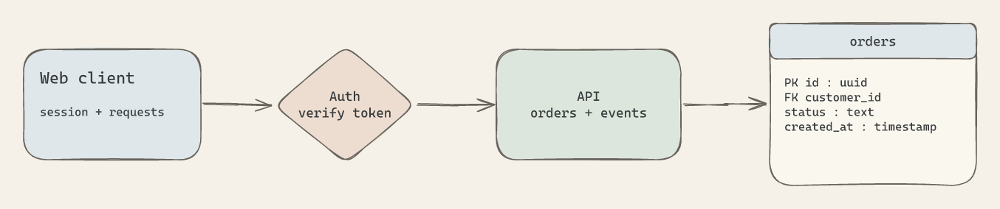

# wydraw

Agent-first local diagrams with pencil strokes, FeedMe orange accents, warm paper, rounded cards, and an editable Excalidraw canvas. Draw through a small CLI, batch changes as JSON, render PNG/SVG headlessly, and switch to cursor mode whenever a person wants to edit.



The default palette uses orange `#FF8125`, pale peach `#FFF0E3`, warm white `#FFFAF5`, and graphite text. Explicit element colors are preserved.

Style is a default, not a notation. Mix objects, people, auth boundaries, services, schemas, tables, keys, relationships, annotations, and native shapes in whatever composition makes the system understandable. No account, CDN, or computer-use automation is required to draw.

## Start

Requires Node 22+.

```sh
git clone https://github.com/Tanwyhang/wydraw.git
cd wydraw
npm ci --ignore-scripts
node scripts/diagram.mjs help
node scripts/diagram.mjs create /tmp/system.excalidraw examples/components.json
node scripts/diagram.mjs open /tmp/system.excalidraw
```

`open` prints a loopback URL. It starts a local, document-specific viewer and warm renderer; it does not open a browser automatically. View mode shows the canvas and icon controls. The pencil enables cursor editing; the check icon saves and returns control to the agent. The separate routing checkbox toggles **Untangle**. Agent writes pause during cursor editing. Each scene is saved as an editable `.excalidraw` file.

## Agent interface

```sh
node scripts/diagram.mjs create scene.excalidraw elements.json
node scripts/diagram.mjs inspect scene.excalidraw
node scripts/diagram.mjs apply scene.excalidraw patch.json --revision HASH_FROM_INSPECT
node scripts/diagram.mjs render scene.excalidraw scene.png
node scripts/diagram.mjs render scene.excalidraw scene.svg
node scripts/diagram.mjs stop scene.excalidraw
```

Create/apply accept `-` for JSON on stdin. `inspect FILE ID...` returns a small selected view. `validate FILE` checks scene structure. Stable IDs and revision checks keep edits scoped and prevent stale overwrites. Rendering works offline without the viewer; an open viewer streams changes and caches exports by revision. No MCP server is automatically registered.

### Cards and groups

A shape's `text` creates a bound label that follows the shape. Group any combination of independent components by giving them native `groupIds`, or use a group declaration:

```json
{
  "elements": [
    {"id":"card","type":"rectangle","width":280,"height":160},
    {"id":"heading","type":"text","x":20,"y":20,"text":"API"},
    {"id":"details","type":"text","x":20,"y":65,"text":"POST /orders"}
  ],
  "groups": [{"id":"api-card","elements":["card","heading","details"]}]
}
```

The same `groups` declaration works in a patch. Members replace that named group's membership; an empty array ungroups it. Bound labels inherit their container's groups. Groups use native Excalidraw selection and dragging; nested groups can be expressed with `groupIds`. Tables can be grouped panels, headers, and field labels, without adopting a special table format.

### Connected arrows

```json
{"id":"flow","type":"arrow","startElementId":"api","endElementId":"database"}
```

Endpoints create reciprocal native shape bindings, so arrows follow shapes during manual dragging. Existing arrows can be connected or reconnected with those fields in an update's `set`; use null to disconnect. Explicit `points` preserve a custom route. Unbound paths remain freeform.

### Optional untangle

```json
{"untangle":true}
```

Apply this patch or select the routing checkbox. A deterministic orthogonal visibility-grid router avoids shape interiors and penalizes bends and crossings. It reroutes unlocked, connected arrows without moving cards; new edits reroute while enabled. Turning it off stops future routing and keeps the current routes.

This is a heuristic, not a guarantee of a crossing-free graph. Rotated endpoints, self-loops, unbound arrows, locked arrows/labels, unreachable paths, and overly dense grids are left unchanged. Labels and freehand decorations are not routing obstacles. Manual route choices can be replaced while enabled. Overlapping cards still need layout work.

### Patch format

```json
{
  "create": [],
  "update": [{"id":"api","set":{"x":120,"text":"HTTP API"}}],
  "delete": [],
  "groups": [],
  "background": "#f5f1e8"
}
```

Delete incident arrows explicitly when deleting shapes. Locked elements reject direct edits. Native colors, fonts, shapes, curves, and positions can be overridden freely. The defaults support clarity without requiring standardized diagrams.

## Development

```sh
npm test
npm run test:viewer
```

Browser tests use local Chrome; CI uses Playwright Chromium. They exercise actual group dragging, bound-arrow movement, cursor handoff, conflict detection, local assets, checkbox persistence, and streamed updates. `npm test` covers groups, connections, obstacles, locks, and deterministic exports.

The viewer is for one user per document. Return to view mode before closing the tab. A crash may leave a transaction `.lock`; confirm no writer remains before removing it. Do not expose the local server publicly. Runtime files and tokens live in ignored `.state/`. Secrets and private diagrams should not be committed.

The native editor is [Excalidraw](https://github.com/excalidraw/excalidraw); normalization and headless rendering use [mcp-excalidraw-server](https://www.npmjs.com/package/mcp-excalidraw-server). Dependencies remain under their respective licenses. Wydraw's original code is MIT licensed.

For workflow coordination and host-driven self-improvement, see [ystack](https://github.com/Tanwyhang/ystack).
